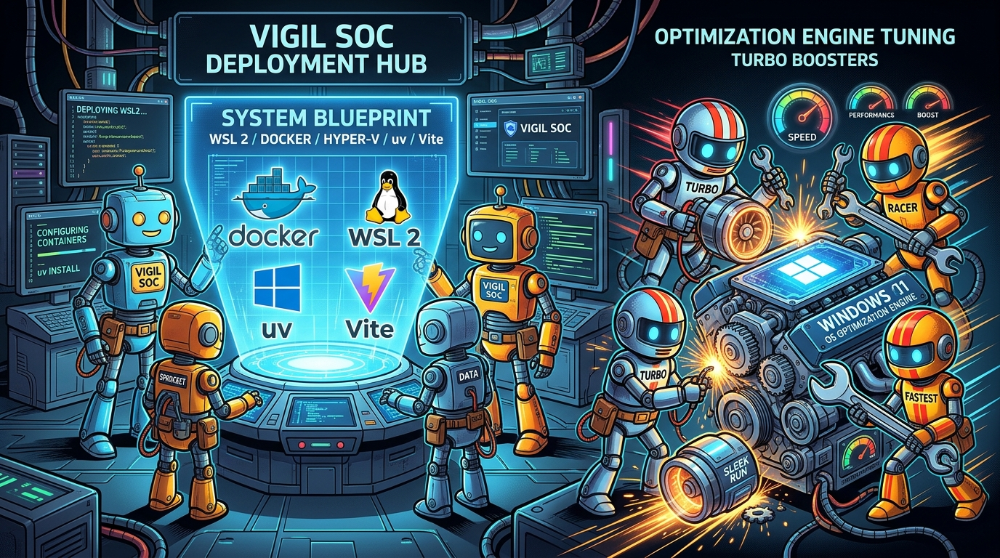

> **This is the lesson from the scary task of deploying VigilSOC on Windows for the first time.**

VigilSOC was architected as a cloud-native, Linux-first autonomous security operations center. In production, our deployments typically run on bare-metal Linux servers or containerized Kubernetes clusters managed by Helm. But security operations rarely operate in an ideal greenfield environment. Enterprise lab environments, security analyst workstations, and hybrid virtualization hosts often mandate Windows 11.

Taking an AI-driven SOC stack—featuring PostgreSQL, Redis, the Bifrost LLM gateway, FastAPI backend services, autonomous agent worker runtimes, and a Vite-based console—and running it reliably on a Windows 11 virtual machine sounds daunting. Between hypervisor virtualization boundaries, Windows Subsystem for Linux (WSL 2) quirks, process lifecycle nuances, and consumer OS background noise, the potential failure modes are numerous.

We recently completed a full bare-metal-to-production deployment of **VigilSOC 1.0.0** on a dedicated Windows 11 Enterprise VM. In this post, we document the entire architectural design, the technical hurdles encountered, why we bound our internal containers strictly to localhost behind native Windows Nginx, and how we stripped over 2 GB of consumer bloatware out of the OS to turn Windows into a lean, hardened SOC appliance.

---

## 1. Virtualization & Subsystem Architecture

Deploying modern containerized workloads on Windows 11 hinges on WSL 2. When the Windows 11 host is itself a virtual machine running under a hypervisor such as Proxmox VE or QEMU/KVM, the first hurdle is nested virtualization.

```
+--------------------------------------------------------------------------+
| Physical Hypervisor (Proxmox VE / KVM)                                    |
| Virtual CPU: "host" (exposes VT-x / AMD-V flags)                         |
+--------------------------------------------------------------------------+
                                     |
                                     v
+--------------------------------------------------------------------------+
| Windows 11 Guest VM                                                      |
| - Hyper-V & VirtualMachinePlatform Enabled                               |
| - Native Nginx (C:\nginx) -> Binds 0.0.0.0:80 / 0.0.0.0:443              |
| - OpenSSH Server (sshd) for Headless Remote Management                  |
| - Stripped Consumer Services (~2.5 GB RAM Reclaimed)                    |
+--------------------------------------------------------------------------+
                                     | (Localhost Forwarding)
                                     v
+--------------------------------------------------------------------------+
| WSL 2 Subsystem (Ubuntu 22.04 LTS / Jammy)                               |
| - Native Linux Docker Engine (docker.io, docker-compose-v2)              |
| - systemd=true (/etc/wsl.conf)                                           |
| - Systemd Unit: /etc/systemd/system/vigil.service                        |
|                                                                          |
| Containers & Daemons (Bound strictly to 127.0.0.1):                      |
| - Frontend Web Console (Vite):         127.0.0.1:6988                    |
| - Backend API (Uvicorn / FastAPI):     127.0.0.1:6987                    |
| - Bifrost LLM Gateway:                 127.0.0.1:8080                    |
| - PostgreSQL:                          127.0.0.1:5432                    |
| - Redis:                               127.0.0.1:6379                    |
| - SOC Daemon & Agent Layer:            services/daemon, worker, agent    |
+--------------------------------------------------------------------------+
```

### Enabling Nested Virtualization

If Windows 11 is launched with a generic virtualized CPU model (such as `kvm64` or `qemu64`), attempting to register or launch any WSL 2 distribution fails immediately:

```text
WSL2 is unable to start since virtualization is not enabled on this machine.
Please ensure the "Virtual Machine Platform" optional component is enabled...
Error code: Wsl/InstallDistro/Service/RegisterDistro/CreateVm/HCS/HCS_E_HYPERV_NOT_INSTALLED
```

In PowerShell, `(Get-CimInstance Win32_Processor).VirtualizationFirmwareEnabled` will report `False`. 

To fix this:
1. In the underlying hypervisor, configure the VM processor type to `host` (e.g., `qm set <VMID> --cpu host` in Proxmox) so Intel VT-x (`vmx`) or AMD-V (`svm`) extensions pass through to the Windows guest.
2. Inside Windows, enable the Hyper-V hypervisor stack and WSL components via elevated PowerShell:
   ```powershell
   Enable-WindowsOptionalFeature -Online -FeatureName Microsoft-Hyper-V-All -All -NoRestart
   Enable-WindowsOptionalFeature -Online -FeatureName VirtualMachinePlatform -All -NoRestart
   Enable-WindowsOptionalFeature -Online -FeatureName Microsoft-Windows-Subsystem-Linux -All -NoRestart
   bcdedit /set hypervisorlaunchtype auto
   ```
3. Reboot the host and confirm `VirtualizationFirmwareEnabled` returns `True`.

### Provisioning the WSL 2 Subsystem

Rather than relying on store-based interactive distribution installers that require a desktop user session, import the official Ubuntu 22.04 LTS (Jammy) rootfs directly:

```powershell
curl.exe -L -o C:\Ubuntu\ubuntu-jammy.tar.gz https://cloud-images.ubuntu.com/wsl/jammy/current/ubuntu-jammy-wsl-amd64-ubuntu22.04lts.rootfs.tar.gz
New-Item -ItemType Directory -Path 'C:\WSL\Ubuntu' -Force
wsl.exe --import Ubuntu 'C:\WSL\Ubuntu' 'C:\Ubuntu\ubuntu-jammy.tar.gz' --version 2
```

Configure `/etc/wsl.conf` to enable systemd init support:

```ini
[boot]
systemd=true
```

---

## 2. Docker Architecture: Headless Daemon vs. Docker Desktop

One of the most consequential decisions when running Vigil on Windows is how to host Docker.

### The Pitfall of Docker Desktop

Docker Desktop on Windows is architected as an interactive GUI desktop application. Its backend process (`com.docker.backend.exe`) is tied to the interactive user desktop session (Session 1). 

If you manage your server headlessly over OpenSSH (`sshd`) or via automated CI/CD tooling (Session 0):
- `com.docker.service` is merely a Windows helper service; the container engine does not boot until a user logs in interactively at the graphical console.
- Closing a desktop session or managing the VM remotely leaves the Docker daemon stopped.

### The Solution: Native Linux Docker Inside WSL 2

By enabling `systemd` inside WSL 2, we bypass Docker Desktop entirely and run native Linux Docker Engine directly within the Ubuntu distribution:

```bash
sudo apt-get update
sudo apt-get install -y docker.io docker-compose-v2
sudo systemctl enable --now docker
```

Native `dockerd` starts automatically whenever the WSL distribution initializes. It runs autonomously in the background, requires zero Windows GUI sessions, and consumes significantly less RAM than Docker Desktop.

---

## 3. Filesystem Performance & Security Exclusions

### Avoid the Cross-Filesystem DrvFs Trap

A common mistake on Windows is checking out the repository on the Windows C: drive (e.g., `C:\Users\...\vigil`) and accessing it inside WSL via `/mnt/c/`.

Cross-filesystem translation via DrvFs introduces severe performance bottlenecks:
- File metadata and permission mappings (`chmod`, POSIX ownership) are simulated.
- Linux `inotify` kernel events do not reliably propagate across the Windows NTFS boundary, breaking frontend hot reloads and log file watchers.
- Docker bind mounts into `/mnt/c` suffer 5x to 10x I/O latency.

**Always clone and execute Vigil directly inside the native Linux ext4 filesystem** (e.g., `/root/vigil` or `/home/analyst/vigil`).

### Taming Windows Defender I/O Saturation

During Docker image layer extraction, Python package installations via `uv`, and Node package dependency builds, Windows Defender Antivirus (`MsMpEng.exe`) can peg the CPU at 100% scanning the WSL virtual disk (`ext4.vhdx`).

Configure exclusions for your WSL virtual disk path and project directories:

```powershell
Add-MpPreference -ExclusionPath 'C:\WSL\Ubuntu'
Add-MpPreference -ExclusionPath 'C:\Ubuntu'
```

---

## 4. Key Engineering Fixes from the Windows Trenches

Deploying VigilSOC 1.0.0 on Windows uncovered several subtle edge cases spanning system clocks, process trees, and line endings. Here are the core issues resolved:

### 1. Clock Steps & Premature Healthcheck Timeouts

During initial boot and parallel container build phases, `systemd-timesyncd` synchronized the WSL guest clock with NTP and the host RTC, stepping the guest clock forward by up to two hours.

In `scripts/lib.sh`, startup healthchecks tracked elapsed time using bash's `$SECONDS` variable:

```bash
# Vulnerable to wall-clock steps:
start=$SECONDS
while [ $((SECONDS - start)) -lt "$timeout" ]; do ... done
```

Because `$SECONDS` is calculated from `time(NULL) - shell_start_time`, an NTP step of +2 hours caused `((SECONDS - start))` to instantly evaluate to `7200 > 300`, causing `wait_for_backend` to abort prematurely even though the service had started cleanly seconds earlier.

**The Fix:** Transition all healthcheck loops to monotonic iteration counters (`elapsed=0; sleep 1; elapsed=$((elapsed + 1))`), ensuring immunity to NTP jumps.

### 2. Headless SSH Process Teardown & WSL Session Cgroups

When executing startup scripts like `./start.sh -d` over remote SSH, background daemons (`uvicorn`, `services/daemon/main.py`, `services.worker`, `vite`) would pass initial health checks but terminate immediately when the SSH connection closed.

In WSL 2, commands executed via `wsl.exe <command>` run inside an ephemeral session cgroup attached to the Windows client IPC pipe. When the calling process closes, WSL `/init` cleans up all child processes in that session scope.

**The Fix:**
1. Enable systemd lingering for the user:
   ```bash
   loginctl enable-linger root
   ```
   and set `KillUserProcesses=no` in `/etc/systemd/logind.conf`.
2. Ensure all background spawns decouple stdin and disown processes:
   ```bash
   nohup "$VENV_UVICORN" ... </dev/null > logs/backend.log 2>&1 &
   disown "$!"
   ```
3. Wrap the stack in a dedicated systemd service (`/etc/systemd/system/vigil.service`):
   ```ini
   [Unit]
   Description=Vigil SOC Daemon Stack
   After=network.target docker.service
   Requires=docker.service

   [Service]
   Type=oneshot
   User=root
   WorkingDirectory=/root/vigil
   Environment="HOME=/root"
   Environment="PATH=/usr/local/bin:/usr/bin:/bin"
   ExecStart=/root/vigil/start.sh -d
   ExecStop=/root/vigil/shutdown_all.sh
   RemainAfterExit=yes
   TimeoutStartSec=360

   [Install]
   WantedBy=multi-user.target
   ```
   Enabling this unit (`systemctl enable --now vigil`) moves the entire stack into systemd's persistent `system.slice`, surviving SSH logouts and reboots.

### 3. CRLF Line Endings in Agent Skills

If the repository was cloned on Windows with Git's default `core.autocrlf = true`, Windows CRLF (`\r\n`) line terminators were introduced into markdown skill manifests (`core/skills/library/*/SKILL.md`).

In `services/agent/plugins/registry.ts`, skill frontmatter extraction used a regex expecting `\n---`. Because of the `\r`, the trailing carriage return was captured into the YAML block. Strict YAML 1.2 parsing choked on the bare `\r` immediately following quoted scalar strings:

```text
YAMLParseError: Unexpected scalar at node end at line 4, column 43: vigil-origin: "epic #882 slice 2, #1077" ^
```

Because `loadSkills()` reads all skills alphabetically upon initialization, the very first skill (`attack-mapping/SKILL.md`) aborted all agent turns.

**The Fix:**
1. Update `parseSkill()` and `parsePlugin()` in `services/agent/plugins/registry.ts` to explicitly normalize `text.replace(/\r\n/g, "\n")` prior to regex matching.
2. Enforce `git config core.autocrlf false` and strip carriage returns across the codebase:
   ```bash
   find core services tools scripts clients -type f \( -name "*.md" -o -name "*.yaml" -o -name "*.json" -o -name "*.py" -o -name "*.ts" \) -exec sed -i 's/\r$//' {} +
   ```

### 4. Dynamic Model Discovery for External Ollama Instances

When Ollama runs on an external LAN server rather than `localhost:11434`, Bifrost's health check passes because it validates the custom key URL. However, the UI's model assignment panel queried `GET /api/ai/models`, which relied on `core/llm/bifrost/admin.py` (`_list_ollama_models`).

`_list_ollama_models` originally checked only the static `OLLAMA_URL` environment variable. By updating it to dynamically query Bifrost's registered key endpoints (`GET /api/providers/ollama/keys`), Vigil discovered and synchronized all pulled models (e.g., `hermes3:8b`, `qwen2.5:7b`) with full token limits and tool support metadata into PostgreSQL.

---

## 5. Network Architecture: Secure Reverse Proxy with Windows Nginx

A cornerstone of our production deployment is network isolation. 

### Why Vigil Containers Bind Strictly to Localhost

In `.env`, we configure:

```bash
BIND_HOST="127.0.0.1"
```

All Vigil backend services and Docker containers bind exclusively to `127.0.0.1`:
- **Vigil Web Console (Vite):** `127.0.0.1:6988`
- **Backend API (Uvicorn):** `127.0.0.1:6987`
- **Bifrost AI Gateway:** `127.0.0.1:8080`
- **PostgreSQL Database:** `127.0.0.1:5432`
- **Redis Cache:** `127.0.0.1:6379`

None of these ports are directly exposed on external network adapters. If an attacker scans the host's physical IP address, database and API ports remain completely invisible.

### Native Windows Nginx vs. WSL Mirrored Networking

To securely expose the web console to analysts over TLS, we evaluated two architectures:
1. *WSL 2 Mirrored Networking (`networkingMode=mirrored`)*: Under nested virtualization on Proxmox, Hyper-V NDIS filter drivers conflict with Docker bridge network virtual ethernet pairs (`veth`), causing virtual switch resets.
2. *Native Windows Nginx (`C:\nginx`)*: Running Nginx directly on the Windows 11 host.

Native Windows Nginx proved overwhelmingly superior:
- It binds directly to `0.0.0.0:80` and `0.0.0.0:443` across Windows network adapters.
- **Windows 11's built-in WSL 2 localhost forwarder automatically connects `127.0.0.1:6988` into WSL 2.** Zero complex `netsh interface portproxy` rules or dynamic IP tracking scripts are required.
- TLS certificates and HTTPS termination are handled cleanly on the Windows host using standard Nginx syntax.

### Nginx Configuration (`C:\nginx\conf\nginx.conf`)

```nginx
worker_processes 2;

events {
    worker_connections 1024;
}

http {
    include       mime.types;
    default_type  application/octet-stream;
    sendfile        on;
    keepalive_timeout 65;

    # Redirect all HTTP traffic to HTTPS
    server {
        listen       80;
        server_name  _;
        return 301 https://$host$request_uri;
    }

    # Terminate TLS and proxy to localhost Vite / Vigil console
    server {
        listen       443 ssl;
        server_name  _;

        ssl_certificate      C:/nginx/ssl/vigil.crt;
        ssl_certificate_key  C:/nginx/ssl/vigil.key;

        ssl_protocols TLSv1.2 TLSv1.3;
        ssl_ciphers HIGH:!aNULL:!MD5;
        ssl_prefer_server_ciphers on;

        location / {
            proxy_pass http://127.0.0.1:6988;
            proxy_http_version 1.1;

            # WebSocket support for live case updates and agent streaming
            proxy_set_header Upgrade $http_upgrade;
            proxy_set_header Connection "upgrade";

            proxy_set_header Host $host;
            proxy_set_header X-Real-IP $remote_addr;
            proxy_set_header X-Forwarded-For $proxy_add_x_forwarded_for;
            proxy_set_header X-Forwarded-Proto https;

            # Extended timeouts for long-running LLM investigation turns
            proxy_read_timeout 300s;
            proxy_send_timeout 300s;
        }
    }
}
```

Only TCP ports 80 and 443 are allowed through the Windows Firewall:

```powershell
New-NetFirewallRule -DisplayName "Vigil HTTPS (443)" -Direction Inbound -LocalPort 443 -Protocol TCP -Action Allow
New-NetFirewallRule -DisplayName "Vigil HTTP (80)" -Direction Inbound -LocalPort 80 -Protocol TCP -Action Allow
```

The Nginx process is registered as an automatic Windows Scheduled Task under `NT AUTHORITY\SYSTEM` with `PT0S` (infinite) execution limits, guaranteeing continuous uptime across reboots.

---

## 6. Transforming Windows 11 into a Hardened SOC Appliance

Out of the box, a standard Windows 11 installation runs dozens of consumer background processes: OneDrive syncing, News and Widgets feeds, Spotlight wallpaper downloads, Xbox game recording hooks, Edge pre-launch engines, and telemetry services.

On a dedicated server hosting an AI security platform, these components represent unacceptable resource contention, CPU wakeups, disk I/O, and unnecessary outbound network polling.

We applied a thorough hardening and debloating regimen that reclaimed **between 1.5 GB and 2.5 GB of RAM** while ensuring that Hyper-V, WSL 2, OpenSSH, and Windows Defender remained intact.

| Category | Component / Process | Action Taken | Why It Was Disabled / Removed | Reclaimed Impact |
| :--- | :--- | :--- | :--- | :--- |
| **Cloud Storage** | **Microsoft OneDrive** (`OneDrive.exe`) | Uninstalled via `OneDriveSetup.exe /uninstall`; GPO `DisableFileSyncNGSC=1` | Vigil stores data in PostgreSQL, Redis, and ext4 VHDX. OneDrive causes unwanted file locks. | ~90 MB RAM; eliminated background sync tasks. |
| **News & MSN** | **Windows Widgets** (`Widgets.exe`, `WidgetService.exe`) | Process terminated; AppX `Client.WebExperience` uninstalled; GPO `AllowNewsAndInterests=0` | Delivers consumer news feeds and ad tiles. Zero utility on a SOC server. | ~100 MB RAM; stopped continuous MSN HTTP polling. |
| **News & MSN** | **Bing News, Weather, Search** | Uninstalled provisioned AppX packages | Standalone consumer UWP applications. | Frees disk space; stops background push listeners. |
| **Lockscreen** | **Windows Spotlight** (`ContentDeliveryManager`) | GPOs: `DisableWindowsSpotlightFeatures=1`, `DisableWindowsConsumerFeatures=1` | Periodically downloads rotating wallpapers, lockscreen ads, and tips from Bing CDNs. | Halts periodic CDN image downloads and disk writes. |
| **Gaming** | **Xbox Gaming Subsystem** | Removed 5 AppX packages (`XboxGamingOverlay`, `TCUI`, etc.); GPO `AllowGameDVR=0` | Social gaming overlays, party chat, and screen recording hooks. | Frees disk space and unregisters kernel display hooks. |
| **Consumer Apps** | **Solitaire, Clipchamp, Teams, Outlook** | Removed AppX packages across all users | Pre-installed consumer apps (card games, video editors, consumer chat). | Completely clears non-enterprise bloatware. |
| **Edge Engine** | **Edge Startup Boost & WebView Persistence** | Policies: `StartupBoostEnabled=0`, `BackgroundModeEnabled=0`, `WebWidgetAllowed=0` | Pre-warms Edge and WebView2 processes in RAM for faster consumer launching. | **Reclaims ~500 MB RAM** immediately. |
| **Telemetry** | **Diagnostic Tracking** (`DiagTrack`, `dmwappushservice`) | Services stopped and set to `Disabled`; Policy `AllowTelemetry=0` | Continuously uploads diagnostic logs, crash reports, and telemetry to Microsoft. | Reduces background CPU, disk logging, and network telemetry. |
| **Search & AI** | **Bing Start Search & Windows Copilot** | Policies: `DisableWebSearch=1`, `TurnOffWindowsCopilot=1` | Sends local Start menu searches over the internet to Bing; injects Copilot panels. | Prevents outbound search tracking and browser webviews. |

### Preserved Core Capabilities

Throughout this optimization, critical infrastructure components were preserved without modification:
- **Hyper-V & Virtual Machine Platform**: Active for WSL 2 virtualization.
- **Windows Subsystem for Linux (WSL 2)**: Running Ubuntu 22.04 LTS and native Docker.
- **OpenSSH Server (`sshd`)**: Continuously active for headless terminal administration.
- **Windows Defender Antivirus & Firewall**: Active with targeted exclusions for the WSL VHDX.
- **Windows Terminal & PowerShell**: Available for system administration.

### The Automated Optimization Script

The entire debloating procedure was codified into an idempotent PowerShell script:

```powershell
# Run from an elevated Administrator PowerShell prompt
Write-Host "=== Hardening Windows 11 Host for Vigil SOC ===" -ForegroundColor Cyan

# 1. Uninstall & Disable OneDrive
Stop-Process -Name "OneDrive" -Force -ErrorAction SilentlyContinue
$od = "$env:SystemRoot\System32\OneDriveSetup.exe"
if (-not (Test-Path $od)) { $od = "$env:SystemRoot\SysWOW64\OneDriveSetup.exe" }
if (Test-Path $od) { Start-Process $od -ArgumentList "/uninstall" -Wait }
$odKey = "HKLM:\SOFTWARE\Policies\Microsoft\Windows\OneDrive"
if (-not (Test-Path $odKey)) { New-Item -Path $odKey -Force | Out-Null }
Set-ItemProperty -Path $odKey -Name "DisableFileSyncNGSC" -Value 1 -Type DWord
Remove-ItemProperty -Path "HKCU:\Software\Microsoft\Windows\CurrentVersion\Run" -Name "OneDrive" -ErrorAction SilentlyContinue

# 2. Disable Widgets & News
Stop-Process -Name "Widgets", "WidgetService" -Force -ErrorAction SilentlyContinue
$dshKey = "HKLM:\SOFTWARE\Policies\Microsoft\Dsh"
if (-not (Test-Path $dshKey)) { New-Item -Path $dshKey -Force | Out-Null }
Set-ItemProperty -Path $dshKey -Name "AllowNewsAndInterests" -Value 0 -Type DWord
Get-AppxPackage -AllUsers *WebExperience* | Remove-AppxPackage -AllUsers -ErrorAction SilentlyContinue

# 3. Disable Windows Spotlight & Consumer Features
$cloudKey = "HKLM:\SOFTWARE\Policies\Microsoft\Windows\CloudContent"
if (-not (Test-Path $cloudKey)) { New-Item -Path $cloudKey -Force | Out-Null }
Set-ItemProperty -Path $cloudKey -Name "DisableWindowsSpotlightFeatures" -Value 1 -Type DWord
Set-ItemProperty -Path $cloudKey -Name "DisableWindowsConsumerFeatures" -Value 1 -Type DWord

# 4. Remove Consumer Bloatware, Solitaire, and Xbox
$bloatApps = @(
    "Microsoft.BingNews", "Microsoft.BingWeather", "Microsoft.BingSearch",
    "Microsoft.MicrosoftSolitaireCollection", "Clipchamp.Clipchamp",
    "Microsoft.GamingApp", "Microsoft.XboxGamingOverlay", "Microsoft.XboxIdentityProvider",
    "Microsoft.XboxSpeechToTextOverlay", "Microsoft.Xbox.TCUI", "Microsoft.XboxGameCallableUI",
    "Microsoft.YourPhone", "MSTeams", "Microsoft.OutlookForWindows",
    "Microsoft.GetHelp", "Microsoft.WindowsFeedbackHub", "Microsoft.WindowsCamera",
    "Microsoft.WindowsSoundRecorder", "Microsoft.ZuneMusic"
)
foreach ($app in $bloatApps) {
    Get-AppxPackage -AllUsers -Name $app -ErrorAction SilentlyContinue | Remove-AppxPackage -AllUsers -ErrorAction SilentlyContinue
    Get-AppxProvisionedPackage -Online | Where-Object DisplayName -eq $app | Remove-AppxProvisionedPackage -Online -ErrorAction SilentlyContinue
}
$gKey = "HKLM:\SOFTWARE\Policies\Microsoft\Windows\GameDVR"
if (-not (Test-Path $gKey)) { New-Item -Path $gKey -Force | Out-Null }
Set-ItemProperty -Path $gKey -Name "AllowGameDVR" -Value 0 -Type DWord

# 5. Disable Edge Startup Boost & Background Persistence (~500 MB RAM saved)
Stop-Process -Name "msedge", "msedgewebview2" -Force -ErrorAction SilentlyContinue
$eKey = "HKLM:\SOFTWARE\Policies\Microsoft\Edge"
if (-not (Test-Path $eKey)) { New-Item -Path $eKey -Force | Out-Null }
Set-ItemProperty -Path $eKey -Name "StartupBoostEnabled" -Value 0 -Type DWord
Set-ItemProperty -Path $eKey -Name "BackgroundModeEnabled" -Value 0 -Type DWord

# 6. Disable Telemetry, Bing Web Search, and Copilot
Stop-Service -Name "DiagTrack" -Force -ErrorAction SilentlyContinue
Set-Service -Name "DiagTrack" -StartupType Disabled
Stop-Service -Name "dmwappushservice" -Force -ErrorAction SilentlyContinue
Set-Service -Name "dmwappushservice" -StartupType Disabled

$dcKey = "HKLM:\SOFTWARE\Policies\Microsoft\Windows\DataCollection"
if (-not (Test-Path $dcKey)) { New-Item -Path $dcKey -Force | Out-Null }
Set-ItemProperty -Path $dcKey -Name "AllowTelemetry" -Value 0 -Type DWord

$sKey = "HKLM:\SOFTWARE\Policies\Microsoft\Windows\Windows Search"
if (-not (Test-Path $sKey)) { New-Item -Path $sKey -Force | Out-Null }
Set-ItemProperty -Path $sKey -Name "DisableWebSearch" -Value 1 -Type DWord
Set-ItemProperty -Path $sKey -Name "ConnectedSearchUseWeb" -Value 0 -Type DWord

$cpKey = "HKLM:\SOFTWARE\Policies\Microsoft\Windows\WindowsCopilot"
if (-not (Test-Path $cpKey)) { New-Item -Path $cpKey -Force | Out-Null }
Set-ItemProperty -Path $cpKey -Name "TurnOffWindowsCopilot" -Value 1 -Type DWord

Write-Host "=== Hardening Complete. ~2GB RAM Reclaimed. ===" -ForegroundColor Green
```

---

## 7. Operational Verification

Following these adjustments, the complete VigilSOC stack was verified running in production on the Windows 11 host:

- **Reverse Proxy**: `curl -k -I https://<host-ip>/` returns `HTTP/1.1 200 OK` (Server: `nginx`), with HTTP-to-HTTPS redirection operational.
- **Core Microservices**: Native Docker Engine hosts `deeptempo-postgres`, `deeptempo-redis`, and `deeptempo-bifrost`, all healthy and bound strictly to `127.0.0.1`.
- **Backend API**: Serving `http://localhost:6987/api/health` with status `healthy`.
- **SOC Daemons**: Background daemon, LLM worker, and agent runtimes running uninterrupted in systemd's persistent slice.
- **Model Discovery**: Multiple local models (`hermes3:8b`, `qwen2.5:7b`) recognized and assignable to individual SOC agents.
- **Web Console**: Fully interactive over HTTPS with live WebSocket investigation streaming.

Deploying VigilSOC on Windows 11 does not have to be a fragile hack. By running native Docker inside WSL 2, terminating TLS with native Windows Nginx, isolating internal microservices to localhost, and stripping away unnecessary consumer OS overhead, Windows 11 transforms into a robust, high-performance host for autonomous security operations.

---

*Questions or deploying Vigil in your environment? Drop into our community channels on [the Vigil community page](https://vigilsoc.org/community/) or explore the repository on [GitHub](https://github.com/Vigil-SOC/vigil).*
