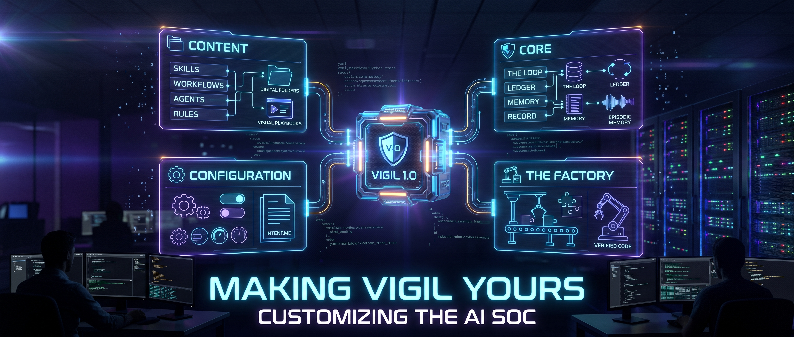

Vigil reached 1.0 this week. Recently the project has drawn attention for a surge in clones and users.

We have learned a lot from the community: conversations on [Discord](https://discord.gg/SBtSHzMYFZ), [office hours](https://luma.com/vigilcommunity), the issues people open, and even posts on X and LinkedIn. Defenders are running Vigil in more ways than expected, and their feedback is steering the project from a system used mainly for investigation and threat hunting toward the broader work of a cyber fusion center. You might even call Vigil the first open source System of Learning for cyber.

With the community growing and Vigil being used for so many purposes, it feels like time to review ways you can customize it. Importantly, a certain sort of customization occurs on its own: Vigil enables the overall system to improve over time. We dug into five ways that a system can improve in Vigil, tying back to recent research by Google and others, in a [recent blog](https://www.deeptempo.ai/blogs/where-the-learning-lives-self-improving-ai-soc).

The focus of this blog is on approaches to customizing Vigil: how to add content, how to configure the system, best paths to take if you want to add custom code, and ways to leverage and feed the Factory which powers Vigil.

In particular, this blog covers:

- **Content:** the skills, workflows, agents and rules that say what the system knows and does.
- **Configuration:** the models it calls and how far it may act on its own.
- **Core capabilities:** the loop, the ledger, the memory and the record, which you build on rather than around.
- **The Factory:** how a need you can specify becomes verified, reviewed code without waiting on a maintainer (assuming the Factory approves your approach, of course!).



## Content

Vigil accesses and updates the know-how used in cyber operations as files under change control, typically stored in GitHub, GitLab or similar.

Skills, workflows, agents and plugins each have a shape, and the console, the daemon and the agent kernel load them at runtime.

**Skills** follow the public [Agent Skills specification](https://agentskills.io/specification): a directory holding a `SKILL.md` whose YAML frontmatter names the skill and whose Markdown body tells an agent how to do one thing. The bundled library lives in `core/skills/library/` and holds skills such as `hunt-method`, `ioc-enrichment`, `phishing-triage`, `beaconing-review` and `rdp-lateral-movement`. Skills are shared across the Python agents, the TypeScript agent kernel and the console; a plugin or agent names the ones it uses and loads them on demand.

**Workflows** tie together particular agents and context. Each is a `WORKFLOW.md` with frontmatter (`name`, `run_kind`, `objectives`, trigger examples) and a Markdown body that reads as a playbook. The built-in workflows sit in `core/workflows/definitions/`: `incident-response`, `full-investigation`, `forensic-analysis`, `cloud-incident`, `threat-hunt`, `root-cause-analysis` and `shadow-adjudication`.

**Agents** answer who does a step. An agent is a role record: prompt, method, tools, model and reasoning budget. The built-in agents are in `core/agents/builtins.py`.

**Plugins** sit one level down, in `services/agent/plugins/`. A plugin declares a run kind (`investigate`, `hunt`, `rootcause`, `compose`, `adjudicate`, `chat`, `tally`) and tells the kernel what the agent is, which capabilities it needs, which skills it loads and how the run ends. Most teams never touch plugins; they matter when you want a new kind of run rather than a new procedure.

**Rules** are the detection logic Vigil runs and reasons about, and they stay in the formats your SIEM already speaks: Sigma YAML, Splunk ESCU, Elastic detection-rules and KQL. Vigil 1.0 does not ship with its own; `scripts/setup_detection_repos.sh` clones the public sets into `~/security-detections`, and `SIGMA_PATHS`, `SPLUNK_PATHS`, `ELASTIC_PATHS`, `KQL_PATHS` and `STORY_PATHS` tell Vigil where each lives.

Vigil's Security-Detections MCP server reads those directories, so agents can lint a rule, replay it against telemetry, map coverage to ATT&CK and draw hypotheses from it. Rules that already run in Splunk or Elastic stay there; Vigil federates to them rather than copying them.

### Authoring inside Vigil

You don't need to write any of the content in Vigil by hand. Describe an agent or a workflow or rule in plain language and Vigil drafts it. The workflow generator takes a scenario such as "investigate a suspicious login and contain the account if malicious" and returns phases, agents and tools drawn from your installed integrations and existing patterns. The agent generator does the same for a role, and refines a draft against your feedback. From a shell:

```bash
python scripts/create_workflow.py <name>
```

Review the draft, commit it, and it is yours.

### Importing skills

Because Vigil reads the open Agent Skills format, skills written for other harnesses work here too. Vigil keeps one skill library, and every agent and plugin reads from it. A skill is a directory holding a `SKILL.md`, with `name` matching the directory. Add one from the console's skill drawer, either by writing it there or by uploading a `SKILL.md` or a `.zip`, or commit it to `core/skills/library/`. An invalid skill is logged and skipped, so one bad file cannot take the library down.

As an example, take Trail of Bits. Their public skills repository ([github.com/trailofbits/skills](https://github.com/trailofbits/skills)) holds forty-plus security skills: `fp-check` for verifying whether a finding is a false positive, `yara-authoring` for writing detection signatures, `semgrep-rule-creator`, `variant-analysis`, `supply-chain-risk-auditor`. Clone the repository, upload `plugins/fp-check/skills/fp-check/` from the skill drawer or copy it into `core/skills/library/fp-check/`, and name it from a plugin or custom agent. A skill written for a code review agent may assume tools Vigil does not expose; trim what does not apply and keep the method. From there you combine it with `investigate-case`, run it inside `full-investigation`, and extend it with your own evidence standards.

### Importing SOAR playbooks

Many teams carry years of SOAR playbooks: XSOAR YAML, Splunk SOAR JSON, Tines stories. A playbook is a procedure, and a Vigil workflow is a procedure in Markdown. Give a capable LLM the playbook, the `WORKFLOW.md` template from `scripts/create_workflow.py`, and the list of agents and integrations you run, and ask for a workflow. Then hand the result to Vigil's own generator to reconcile it against installed tools. Where the playbook had a human checkpoint, set `approval_required: true` on that phase so the run parks until a person answers. Importantly, where it had brittle branching on exact field values, let an agent read the evidence instead; this is one of the benefits of AI SOCs, their ability to run workflows with more resilience. The translation takes an afternoon; what you keep is the institutional knowledge the playbook encoded.

### Pointing Vigil at your rules

Detection rules are in repositories too. `./scripts/setup_detection_repos.sh` clones SigmaHQ, Splunk ESCU, Elastic detection-rules and the community KQL set, which means roughly 7,000 rules. The paths live in environment variables (`SIGMA_PATHS`, `SPLUNK_PATHS`, `ELASTIC_PATHS`, `KQL_PATHS`, `STORY_PATHS`), so point them at your own repositories, the same way you pointed the skills root at your own folder. Rules then serve across use cases: coverage assessment, hunt hypotheses, correlation inside an investigation. [Release 0.7](/blog/2026/10/08/vigilsoc-0-7-0-release/) added Sigma lint and replay and SIEM federation; [the 1.0 release post](/blog/2026/10/30/vigilsoc-1-0-0-release/) sketches the roadmap, and 1.1 and 1.2 carry a good deal more [detection engineering](/docs/detection-engineering/).

## Configuration

Authoring rules, workflows and agents changes what Vigil knows. Configuration changes alter how your deployment of Vigil behaves. There are more ways to adapt and customize Vigil than might be immediately obvious.

**Models.** Providers and keys are set under **Settings → AI models**: Anthropic, OpenAI, Google Vertex and Ollama. Each component can carry its own assignment, so a cheap local model can run basic triage while a frontier model acts as the lead investigator. `DEFAULT_MODEL` fills any gap. The open source Bifrost sits in front of each call as a gateway, with a spend budget.

**Declared intent.** `INTENT.md` at the repo root records what the daemon may do unattended, as machine-readable frontmatter over an operator's note. Every key is an existing knob:

- `triage.auto_triage` and `enrich.auto_enrich`: run AI triage and threat intel enrichment on new findings without being asked.
- `respond.auto_response`: let the daemon execute response actions on its own.
- `respond.confidence_threshold` (0.90), `review_threshold` (0.85), `monitor_threshold` (0.70): the bands that decide whether a finding is acted on, offered to AutoOps intake, or merely watched.
- `act.reversible` and `act.irreversible`: unattended outside action, off until a person raises the ceiling. `four_eyes` adds a two-person rule.
- `investigate.enabled`: the autonomous orchestrator, with `max_cost_per_investigation`, `max_total_hourly_cost` and `max_runtime_per_investigation` as budgets.

Set `ORCHESTRATOR_DRY_RUN` to watch what would happen before it does. Set `DAEMON_FORCE_APPROVAL` to hold every action for a person. Raise `ORCHESTRATOR_MAX_AGENTS` above three when approvals are clogging the slots. Moving toward full autonomy is a sequence of these changes, made in Settings or the environment and declared in `INTENT.md`, so each one is recorded under version control and each one reversible; at startup the daemon logs any setting that differs from what the file declares.

## Beyond configuration

Suppose the content and the knobs are not enough. Three things come next.

**Read the roadmap.** The pace of change has picked up now that Vigil's foundation is largely set. [The 1.0 post](/blog/2026/10/30/vigilsoc-1-0-0-release/) lists what is in flight: native OpenCTI integration, expanded threat intel chains, zero-start enrichment, federated detection and multi-SOC orchestration. [The project board on GitHub](https://github.com/orgs/Vigil-SOC/projects/1) shows what is being groomed and built this week and upcoming milestones. Check before you build; the thing you need may be a release away.

**Talk to the community.** [Office hours](https://luma.com/vigilcommunity) are scheduled on Luma and maintainers attend. [Discord](https://discord.gg/SBtSHzMYFZ) has `#general` and `#releases`. Bring a concrete scenario. The people answering wrote the code, and a question posed well often turns into an issue groomed by the next morning.

**Build on the core.** Every agent run is one loop, the kernel, driven by a plugin. The kernel does the work every run needs: it opens the run, reads episodic memory once as a recall event, runs the tool loop with budgets and approvals, journals every tool call to the ledger as a numbered event the model can cite, rebuilds the transcript on resume so a crash re-runs nothing, and closes with exactly one terminal. On top of that sit the five things that let a run be trusted and learned from:

- The hypothesis record: `propose_hypothesis`, `link_evidence`, `open_question`.
- Declared gaps on every conclusion, computed from the ledger.
- Classified results: served, visibility gap, or defect.
- A frame per model call: hashes of the prompt, task, recall block, tool schemas, skill bodies and model parameters, so replay can rebuild any call's input from the ledger alone and diff it.
- Judges and subagents run on their own ledger, their spend charged to the parent.

Memory closes the loop: when a case closes, the distil pass writes episodic memory, and later runs recall it by entity.

Build your customization on these primitives and it inherits the audit chain, the replay and the learning for free. It is not recommended to alter their foundations; you risk losing the control, reliability and learning of Vigil.

**Write an epic.** The factory exists so that the project's rate of change is set by the quality of its backlog rather than by the hours its maintainers have. It is the software factory DeepTempo built to build Vigil, released in September so anyone can inspect or run it.

Agents groom each issue against a `principles.md`, implement the ones that pass, verify what they built, review it independently and repair their own sandbox when a check cannot run. Every step is visible in GitHub: labels, comments and pull request descriptions are the factory's state, and a reply on an issue is an input to it.

For a potential contributor, this means a well-specified need is itself a valuable and sufficient contribution that will result in improvements to Vigil. Write a complete epic: the behavior, the boundaries, and an acceptance test a reviewer can run. The factory turns it into verified code, a maintainer merges it, and you watch the entire process in the open. Read how the factory works in [Yet another software factory](/blog/2026/09/14/yet-another-software-factory/) and the code at [github.com/Vigil-SOC/vigil-factory](https://github.com/Vigil-SOC/vigil-factory).

## Summary

As Vigil's community continues to grow, more and more cyber engineers are looking at it to address their use cases. As it is only 1.0, the temptation may be to fork it and to add to it. After all, code has never been easier to write.

This blog sets out ways to customize Vigil, many of which do not require additional code being contributed upstream to Vigil.

Start with content, which is files in folders: author it in Vigil, import it from others, or point Vigil at the repositories you already keep. Don't forget configuration when you want different models or more autonomy, and remember to record each change in `INTENT.md`. When that is not enough, and new code is indeed the answer, read the roadmap, come to office hours, build on the loop, the ledger and the memory, and write the epic. The factory will take it from there, and the result will be a better upstream, which benefits us all.
