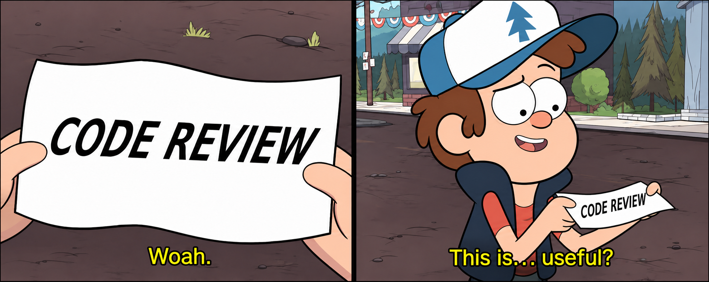

tl;dr - it still comes down to the spec.

[Yesterday](https://vigilsoc.org/blog/2026/11/10/great-specs-no-code-review/) we reported that prompting an agent for code review and live verification didn't improve anything on SlopCodeBench. That was awkward for us, because those are two of the bets [Vigil Factory](https://github.com/Vigil-SOC/vigil-factory) makes when it builds [Vigil](https://github.com/Vigil-SOC/vigil). When we looked into why, the specs in SlopCodeBench turned out to be unusual. They almost always contain worked input/output examples, so the plain agent pipes those examples into its program and checks its own work without being told to.

Vigil's backlog doesn't look like that. Our issues rarely come with worked examples, so the first run was mostly testing a situation Vigil Factory never sees.

## Step 2: Take the examples out

For this second run, we wanted the specs to be more realistic without making them dumb. We kept the schemas, field tables, and error definitions, and stripped out only the worked examples.

Comprehensive schemas and tables are still a lot more detail than most issues people hand to agents. That's the hard part of evals. You can't build a one-size-fits-all benchmark that matches every real workflow, because real tasks vary too much, so we still don't know how far these numbers generalize. Taking the examples out does bring the specs down a notch, and we wanted to see what that does.

A single run on 20 problems also carries plenty of rerun noise (something [@joelniklaus](https://x.com/joelniklaus) showed on his [Harness Leaderboard](https://huggingface.co/spaces/joelniklaus/harness-leaderboard)). So we reran all four original setups on Claude Sonnet 5.5 alongside two new setups without examples: 20 problems, 101 checkpoints per setup, about $237 in total.

| Setup | Cost per checkpoint | Hidden tests passed | Erosion (lower is better) |
|---|---|---|---|
| Plain | $0.27 | 92.4% | 0.870 |
| Vigil Factory's rules | $0.29 | 90.1% | 0.830 |
| + reviewer | $0.41 | 90.5% | 0.817 |
| Tests first | $0.34 | 91.9% | 0.780 |
| Plain (no examples) | $0.27 | 85.4% | 0.852 |
| + reviewer (no examples) | $0.43 | 87.4% | 0.840 |

## What actually happened

Taking the worked examples out hurt. When the spec stops showing what the output is supposed to look like, the plain agent has a harder time verifying its own work.

Without the examples, adding a reviewer gave a small gain on hidden tests over plain Claude Code. On the full specs it still didn't help at all. On erosion, tests first came out lowest, the reviewer second, and Vigil Factory's live-verification rules third. All three left cleaner code than plain Claude Code.

## Is the extra cost worth it?

Not really. The reviewer still adds about 50% to 60% to the cost.

It depends on whether you optimize for passing hidden tests or for keeping erosion down over time, and in a real repo it isn't easy to say which matters more. For Vigil, where a factory stacks change on change with little human review, keeping erosion low counts for a lot. Even so, writing tests first gets the lowest erosion for far fewer tokens than a reviewer. That's uncomfortable for us, because Vigil Factory removed unit and integration tests altogether.

## What this means for Vigil Factory

We're not changing Vigil Factory's rules on two runs. But the direction is clear enough to watch. The less a spec shows, the more an outside check is worth, and Vigil's issues show a lot less than SlopCodeBench's.

Stripping out examples is only one step toward how people actually prompt agents. Most of the drop came from a handful of problems while the rest barely moved, which suggests some specs lean on examples to resolve ambiguity and others don't. Next we want to look closer at why those problems failed, and to test specs that look more like normal (lazy) GitHub issues, the kind Vigil Factory picks up every day.

Results from this run are in [verification-layers](https://github.com/Vigil-SOC/verification-layers-deploy/tree/main/results/seed-2). If you have a rule set you want us to test, get in touch. And if you want to see what a lights-off factory builds, [try Vigil](https://github.com/Vigil-SOC/vigil) or send it a PR; [Vigil Factory](https://github.com/Vigil-SOC/vigil-factory) will review it.
