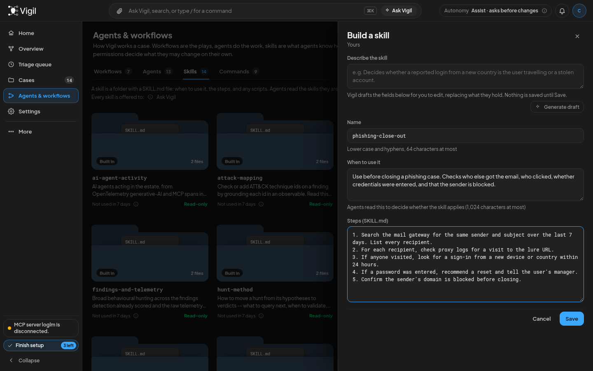
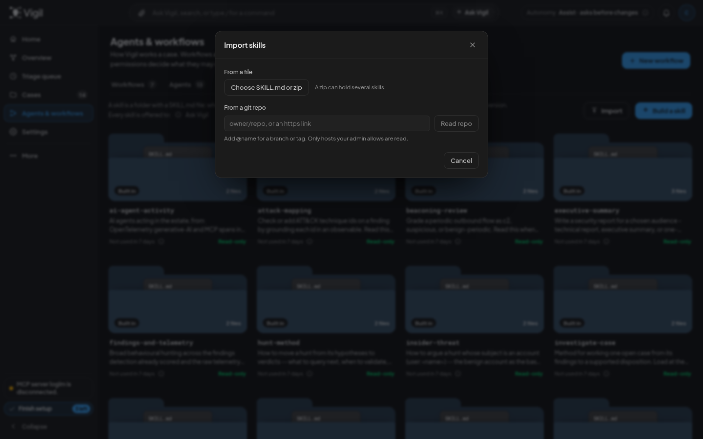
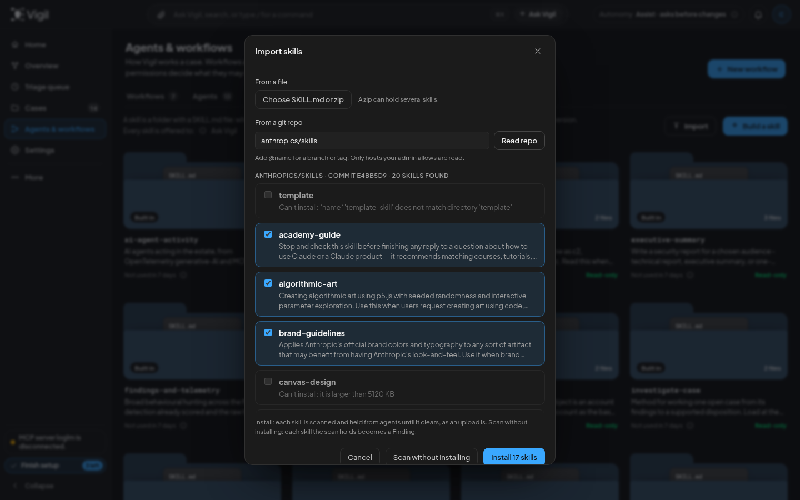
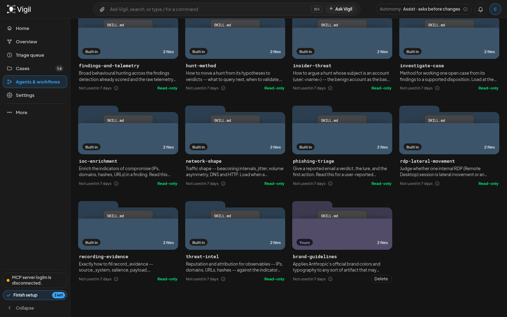

In [Making Vigil Yours](https://vigilsoc.org/blog/2026/11/03/making-vigil-yours/) we covered content, configuration and the core, and skills got one short section. This is the long version.

Before your team closes a phishing case, someone runs the checklist. Did anyone else get the same email? Did anyone click? Was a password typed into the lure page? Is the sender blocked? That checklist lives on a wiki page, or in one senior analyst's head. Until now, Vigil's agents never saw it. They worked from the method Vigil ships with, which is good, but it isn't yours.

A skill changes that. It's a folder with a `SKILL.md`: your process, written in plain text, the way you'd explain it to a new analyst. Write the phishing checklist down as a skill, and when an agent works a phishing case, it reads your steps and follows them. You don't need code or a new integration, just the words your team already uses. It's the same open [Agent Skills](https://agentskills.io) format Claude Code and `npx skills` use: a folder named after the skill, with a `SKILL.md` whose frontmatter gives a lowercase, hyphenated `name` (up to 64 characters) and a `description` (up to 1,024). Anything else in the folder, such as `scripts/` or `references/`, travels with it. So a skill written for another agent works in Vigil, and one you write in Vigil works elsewhere.

Here's how to get your team's know-how into Vigil, and how Vigil makes sure it's safe before any agent uses it.

## Why your own skills

Vigil already ships a `phishing-triage` skill. It knows how to read headers, judge a lure and pull out the indicators. What it can't know is how your team does it: which mail gateway to search, who gets told when a password was typed in, and when a click means a password reset rather than a call to the user's manager.

That's the gap a skill of your own fills. The built-in skill brings the general method, and yours brings the local rules. Together, the agent works the case the way your best analyst would, on every shift, not only the ones that analyst works.

Writing it down pays off in two more ways. Your process stops living in one person's head, so it survives holidays and handovers. And when it changes, you update the skill once, and every case after that follows the new steps.

## Three ways in

Skills live under **Agents & workflows → Skills**. There are three ways to add one.

### Build it in Vigil

Click **Build a skill** and fill in three things: a name, a line on when to use it, and the steps. The "when to use it" line matters most, because agents read it to decide whether your skill applies to the case in front of them. Our phishing close-out skill might look like this:

```markdown
---
name: phishing-close-out
description: Use before closing a phishing case. Checks who else got the email, who clicked, whether credentials were entered, and that the sender is blocked.
---

1. Search the mail gateway for the same sender and subject over the last 7 days. List every recipient.
2. For each recipient, check proxy logs for a visit to the lure URL.
3. If anyone visited, look for a sign-in from a new device or country within 24 hours.
4. If a password was entered, recommend a reset and tell the user's manager.
5. Confirm the sender's domain is blocked before closing.
```



If you'd rather not start from a blank page, describe the skill in a sentence and Vigil drafts it for you to edit. **Test with a sample** then shows how an agent uses it before you rely on it.

### Import a file

Already have skills written for Claude Code or another agent? Click **Import** and choose a `SKILL.md`, or a zip. A zip can hold a whole folder of skills, and the import is all or nothing: if any skill in it can't be installed (it doesn't parse, its name is taken, it's too large, or it contains a symlink), Vigil refuses the whole zip and installs none of them. That check is about whether a skill is well-formed, not whether it's safe. The security scan comes next, once the skills are installed, and holds each one on its own; more on that [below](#checked-before-agents-see-it).



### Import from a git repo

In the same dialog, paste `owner/repo` or a GitHub link to a folder, and add `@branch` to pick a branch or tag. Vigil reads the repo and lists every skill it finds, each with a tick box. A skill that can't be installed says why: its name is taken, it's too large, or it doesn't parse. Untick what you don't want and click **Install**. Vigil remembers the repo and commit each skill came from, which we'll come back to. Only hosts your admin allows can be read; GitHub is the default.

The screenshots below use Anthropic's public [anthropics/skills](https://github.com/anthropics/skills) repo to show the dialog. The walkthrough at the end uses a security-focused one.





## Checked before agents see it

Your phishing checklist is safe to hand an agent because you wrote it. A skill from someone else's repo is a different matter: it could tell an agent to send data somewhere, or to skip a step you care about.

So Vigil checks every skill you add, however it got in. It scans the whole skill folder, `SKILL.md` and any scripts or reference files beside it, with [NVIDIA SkillSpector](https://github.com/NVIDIA/skillspector) in a separate, locked-down process, and holds the skill back from every agent until the scan clears it. While it's held, its card says **Held**, and its panel shows what the scan found and why.

If the scan flags something you've reviewed and are happy with, someone with the `skills.approve` permission (admins, by default) can click **Approve anyway**. Treat that as a review, not a routine bypass. Read the whole skill, not just the finding, and look for:

- instructions aimed at the agent rather than the analyst, such as "ignore previous instructions" or text hidden in comments or odd encodings;
- URLs, webhooks or email addresses the skill sends data to, especially ones your team doesn't own;
- steps that tell the agent to dismiss, suppress or downgrade alerts, skip approvals, or close cases early;
- scripts that fetch and run code, or reach for credentials and tokens.

If you can't explain why a flagged line is there, delete the skill instead. The approval covers exactly the version they read. Edit the skill afterwards and it's scanned again, so nobody can approve a harmless version and then swap in something else.

The check doesn't stop at the door, either. If a skill is held while a run is already going, that run can't load it from then on.

Want to see what a repo would trip before you install anything? **Scan without installing** in the Import dialog scans the skills you've ticked, and each one the scan would hold shows up as a finding.

## Where it gets used

Once a skill clears, it goes to work. Vigil's workflows are all offered the skills you add, alongside the built-in ones they already use. So does Ask Vigil, the chat interface.

An agent doesn't read every skill up front. It sees a short list of names, each with its "when to use it" line, and loads a skill's full steps only when the case in front of it matches. That's why that one line matters so much: it's how the agent knows your checklist exists.

So when an investigation picks up a reported phishing email, it sees `phishing-close-out` in its list, reads that it applies before closing a phishing case, and loads your steps. And because it reads the skill at that moment, it always gets your latest version.

You can see it happening, too. Each skill card shows how often agents used it in the last seven days, and how many different agents did.

## Keeping a library current

A skill you import from a repo doesn't freeze at the version you installed. Its panel says where it came from, such as "From owner/repo · commit 4e1b2c9", and offers **Update library**. When the repo has moved on, the button tells you: **Update library · new version**.

Click it and Vigil reads the repo again and shows what's different, in three groups:

- **Changed**: skills that are different in the repo now.
- **Gone from the repo**: skills the repo dropped, which you can remove here too.
- **In the repo, not installed**: skills you skipped last time, or that were added since.

Tick what you want and click **Update**. Everything that comes in is scanned again, the same as the first time.

Say you took a phishing skill from a shared repo and added your own mail gateway to it in Vigil. An update won't quietly wipe that out. Skills you've edited start unticked, with a warning that updating replaces your edits, so you decide one skill at a time.

And when you're done with a library, you can delete one skill from it, or the whole library at once. Deleting the whole library removes every skill that came from that repo, and Vigil stops tracking it.

## From a repo to a closed case

Here's the whole path in one go. To make it concrete we'll use a public community repo, [mukul975/Anthropic-Cybersecurity-Skills](https://github.com/mukul975/Anthropic-Cybersecurity-Skills), a collection of over 800 security skills. It's only an example. Neither Anthropic nor the Vigil project made, reviewed or endorses it, and the same goes for any third-party repo: a SkillSpector pass is a safety net, not a vetting process. Import only the skills you need, and read each one before you rely on it. Your own `phishing-close-out` is already in Vigil from earlier.

**1. Import.** In **Import**, paste `mukul975/Anthropic-Cybersecurity-Skills` and click **Read repo**. Vigil lists every skill it finds. Keep `conducting-phishing-incident-response` ticked, untick the rest, and click **Install**.

**2. Scan.** Vigil scans the skill before any agent can see it. If the scan flags something, the card says **Held** and its panel shows why. Someone reads the whole skill, using the checklist [above](#checked-before-agents-see-it), and either an admin clicks **Approve anyway** or you delete it. Even if it clears, skim its steps before the first case uses it. Until then, no agent sees it.

**3. Use.** Later, a user reports a suspicious email and Vigil investigates it. The agent now has three skills that fit, and each does a different job. The built-in `phishing-triage` decides whether the email is phishing: headers, the lure, the indicators. The community skill picks up once it is, covering the response side `phishing-triage` doesn't: sandboxing links and attachments, purging the message from every mailbox, and fixing compromised accounts. `phishing-close-out` adds your team's rules before the case closes. The agent loads what the case calls for, so the case is triaged the standard way, responded to thoroughly and closed your way.

**4. Check.** Back on the Skills tab, the card reads **Used 1 time in 7 days · by 1 agent**.

**5. Keep current.** When the repo's author improves that skill, **Update library · new version** shows it under **Changed**. You update, it's scanned again, and the next case follows it.

One last thing before you try it. Vigil reads only public repos for now, so for a private one, download it as a zip and import that. And playbooks, which run a fixed sequence of steps, don't use your skills; [workflows](/docs/agents/#workflows), where agents decide what to do next, and Ask Vigil do. For how agents load skills and which tools each one gets, see the [agents docs](/docs/agents/). If either limit gets in your way, or you've written a skill you think others should have, tell us on [GitHub](https://github.com/Vigil-SOC/vigil) or in [Discord](https://discord.gg/SBtSHzMYFZ).
